# Medical Visit Summary System

A local, privacy-first prototype that records a doctor–patient conversation, transcribes it, extracts the facts that
were actually said, and produces a doctor-reviewed, electronically signed visit summary for the doctor and a
plain-language summary for the patient. A doctor-only clinical assistant helps with the selected patient, using
curated official sources (including the Israeli Ministry of Health medicines registry).

The interface is available in **Hebrew, Arabic and English** (right-to-left for Hebrew and Arabic, left-to-right for
English). All processing runs on the local computer: speech recognition with faster-whisper, language models with
Ollama. No visit data is sent to a cloud service.

> **Educational prototype, tested with fictional patients only.** It is not a certified medical device, it does not
> diagnose or prescribe, and it has not had a HIPAA or 21 CFR Part 11 assessment. Do not use it with real patient
> data. See `medical_visit_mvp/data/documents/COMPLIANCE_MATRIX.md`.

---

## Screenshots

All screenshots use fictional demo accounts and patients.

### Sign in
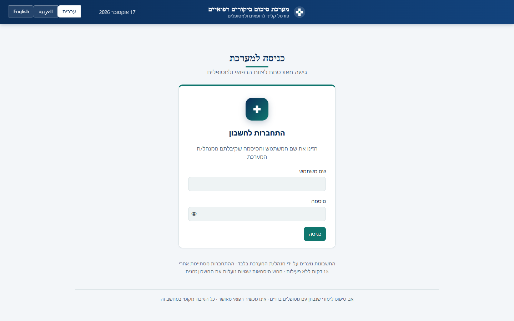

### Doctor — transcript review and speaker assignment
The visit header, the three work tabs, and the reviewed transcript with each segment assigned to doctor or patient.
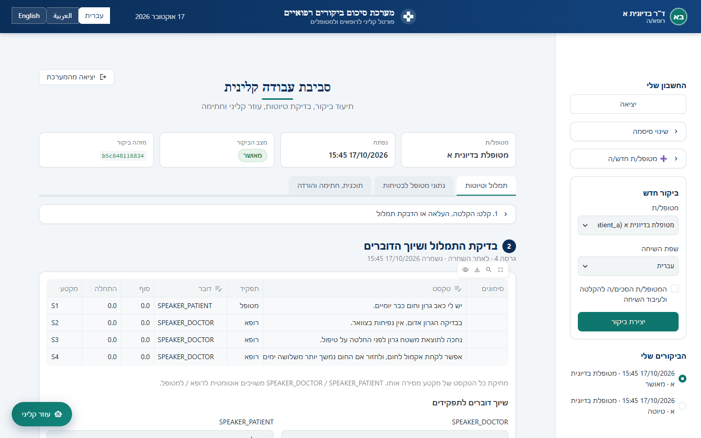

### Doctor — drafts
The doctor's draft (every fact with its category and transcript segment) and the plain-language patient summary.
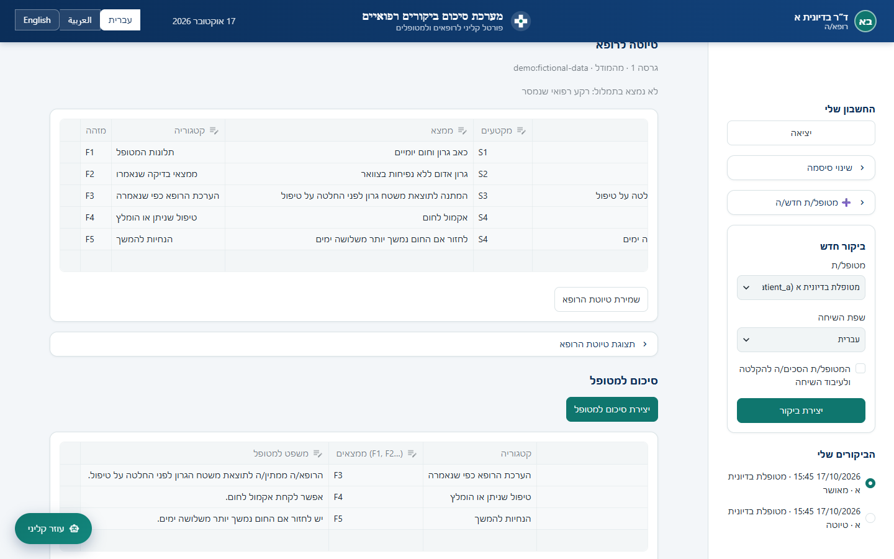

### Doctor — patient safety data
Age, pregnancy, lactation, allergies, regular medications and kidney/liver function, entered and confirmed by the doctor.
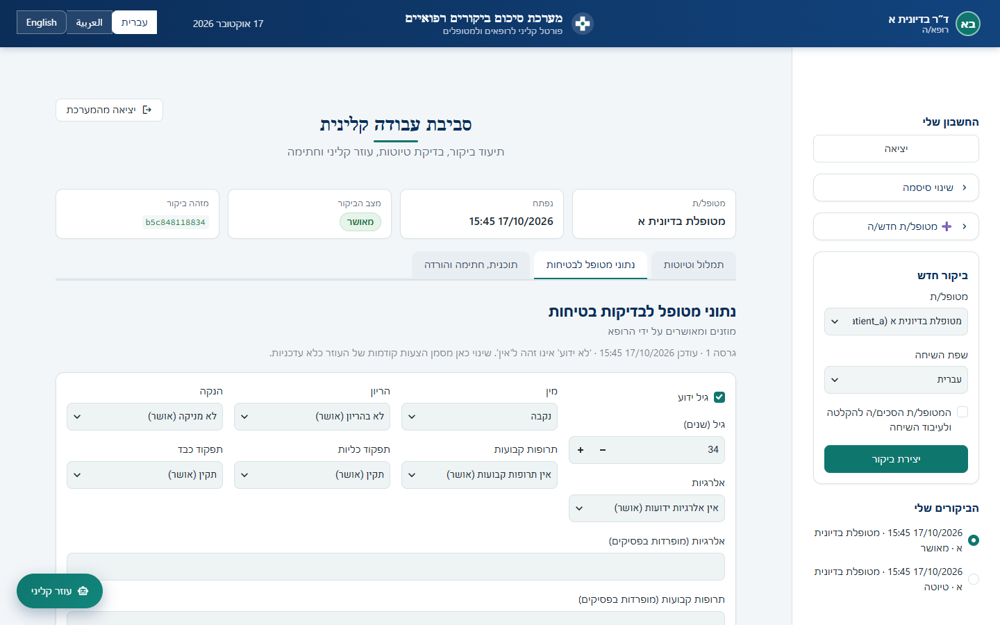

### Doctor — plan, electronic signature and download
The doctor's post-visit plan, the signed approval (name, UTC time, SHA-256) and the PDF / text / JSON downloads.
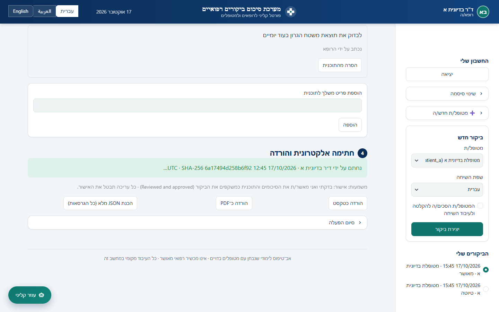

### Clinical assistant — patient summary
The side panel opened from the floating button: patient and visit selection, quick actions, and an answer organized
into colored sections (known facts with their record references, missing information).
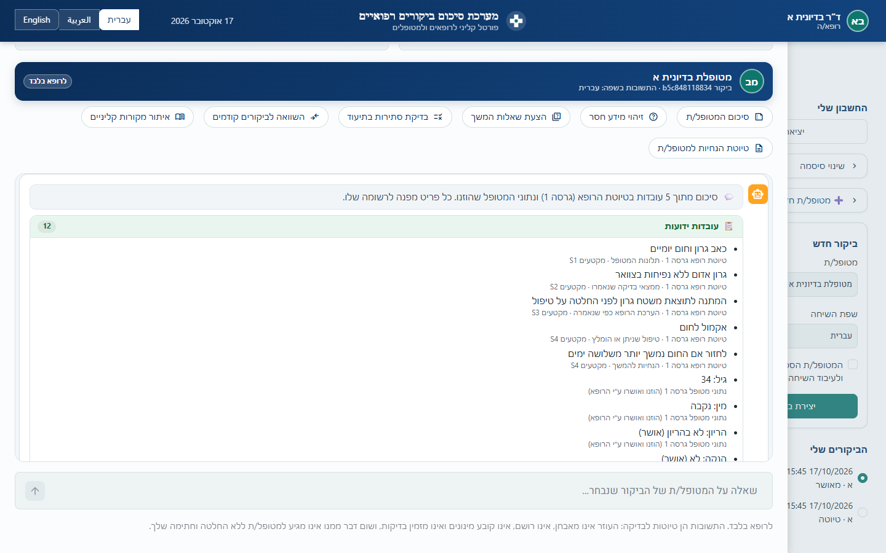

### Clinical assistant — comparison with a previous visit
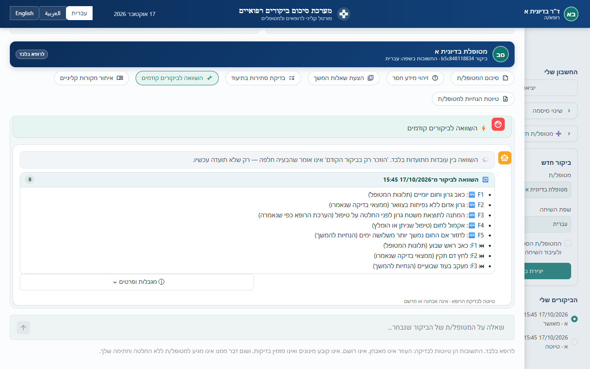

### Clinical assistant — clinical references
Retrieved passages with document type, organization, update and retrieval dates, links, and applicability warnings.
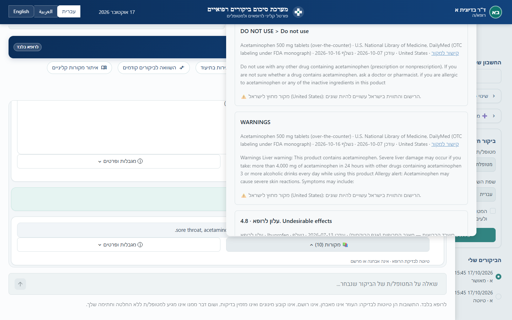

### Patient — signed visit summaries
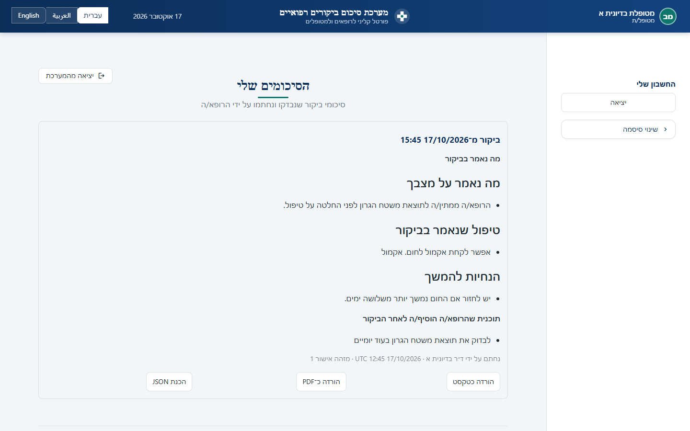

### Administrator — users and roles
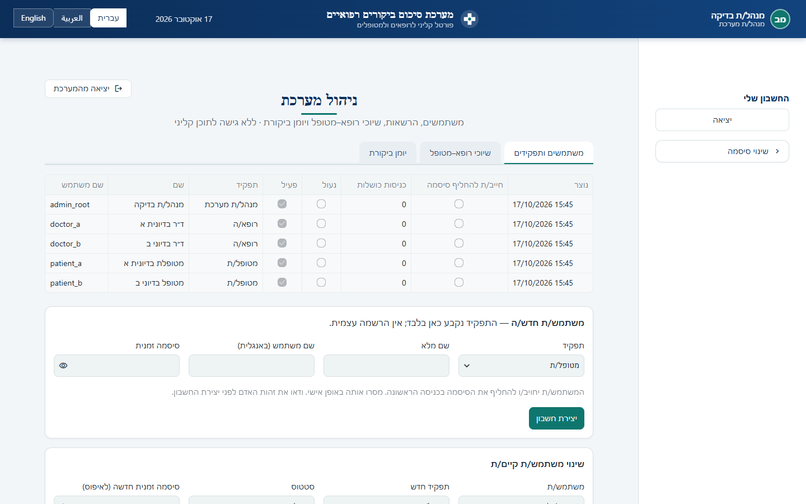

### Administrator — doctor–patient assignments
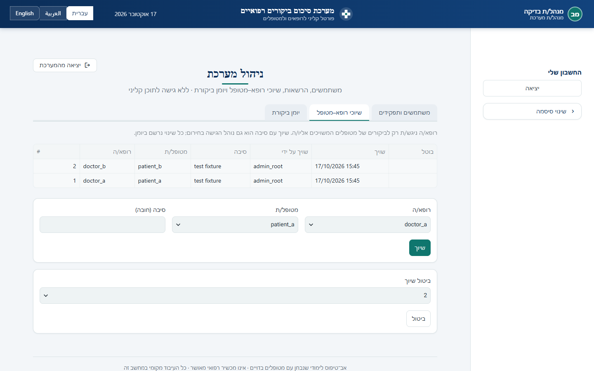

### Administrator — audit log
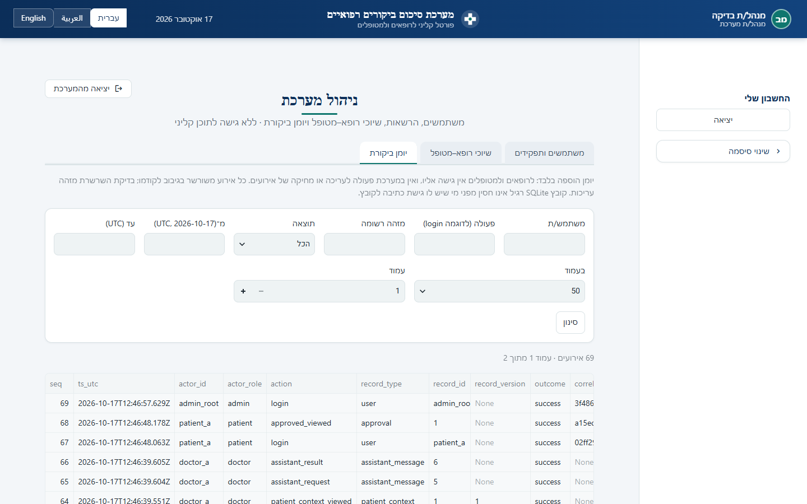

### English interface (left-to-right)
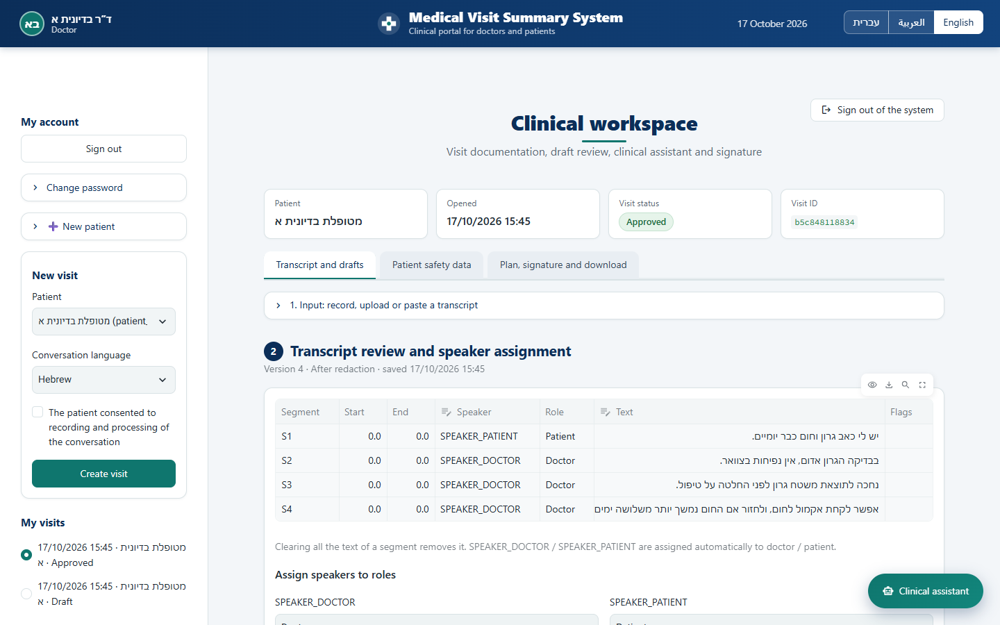
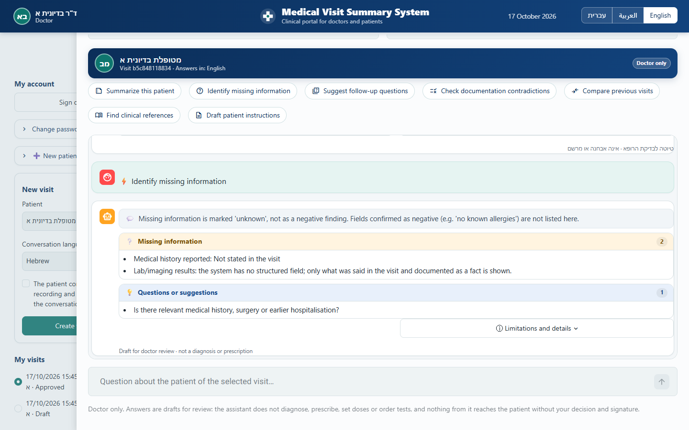

### Arabic interface (right-to-left)
Each assistant answer keeps the language and direction it was written in (here an English answer above an Arabic one).
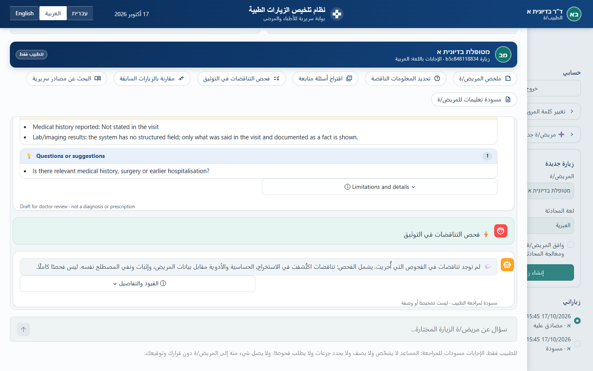

---

## Features

### Doctor
- **Visit capture**: record with the computer microphone, upload an audio file (up to 10 minutes / 24 MB), or paste a
  transcript with `Doctor:` / `Patient:` prefixes (Hebrew and Arabic prefixes also work).
- **Transcript review**: edit segments, assign speakers to doctor/patient, run redaction of identifying details
  (names, phone numbers, IDs) and confirm it before anything is sent to a model.
- **Fact extraction**: every fact cites the transcript segment and an exact quote. Code checks each fact (quote
  found, speaker role, negation, numbers, doses, foreign words, duplicates) and blocks unsupported ones.
- **Patient summary** in plain language, generated only from the reviewed facts.
- **Patient safety data** entered by the doctor (age, pregnancy, allergies, regular medications, kidney/liver
  function). "Unknown" is always kept separate from a confirmed negative.
- **Doctor's plan** after the visit, kept separate from what was said in the visit.
- **Electronic signature**: re-entering username and password, recorded with name, UTC time, meaning and a SHA-256
  of the signed content. Any later edit revokes the approval.
- **Exports** of the signed record: PDF, text and full JSON, in the interface language.

### Clinical assistant (doctor only)
Opened from the floating **Clinical assistant** button. The doctor chooses a patient and a visit, then asks a question
or uses a quick action:

| Quick action | How it works |
|---|---|
| Summarize this patient | Deterministic, every item linked to its record |
| Identify missing information | Deterministic |
| Suggest follow-up questions | Local model, output validated |
| Check documentation contradictions | Deterministic |
| Compare previous visits | Deterministic, same patient and same doctor only |
| Find clinical references | Retrieval only, with source, organization, update and retrieval dates |
| Draft patient instructions | Local model rewords the doctor's own plan items; validated |

Answers are organized into known facts, missing information, questions/suggestions, sources and uncertainties.
Every suggestion is a **draft**: the doctor accepts, edits or rejects it, the decision is audited, and accepted items
enter a new plan version. Patients see plan items only after the doctor signs. A change in patient data marks earlier
suggestions as out of date.

Boundaries enforced in code (not only in prompts): authorization per visit, unrelated or prompt-injection requests
refused, no doses, no medication or number that is not in the record or the retrieved sources, citations must be
verbatim quotes from retrieved passages, model text in the wrong language is removed. Drug-interaction checking is
**not available** (no validated interaction database is integrated) and is shown as such.

### Patient
- Sees only their own visit summaries **after** the doctor signed them, and can download them.

### Administrator
- Creates doctor and patient accounts (no self-registration), assigns patients to doctors, resets passwords, and
  reviews the append-only, hash-chained audit log. Has no access to clinical content.

---

## Requirements

- Windows 10/11 (the scripts below use PowerShell; the code itself is plain Python)
- Python 3.13 (the version this project was developed and tested with)
- [Ollama](https://ollama.com) running locally, with the models:
  ```powershell
  ollama pull qwen3:8b     # extraction and patient summaries
  ollama pull qwen3:4b     # clinical assistant (faster); qwen3:8b gives better answers
  ```
- Internet access only for the first download of the speech model and for refreshing the reference sources

## Installation

The scripts expect the virtual environment **next to** the project folder (`Medical_Visit_MVP\venv`).

```powershell
cd C:\path\to\Medical_Visit_MVP
py -m venv venv
.\venv\Scripts\python.exe -m pip install -r medical_visit_mvp\requirements.txt
cd medical_visit_mvp
copy .env.example .env          # then edit .env (see below)
..\venv\Scripts\python.exe -m backend.manage migrate
```

Recommended settings in `medical_visit_mvp\.env`:

| Setting | Purpose |
|---|---|
| `AUDIT_HMAC_KEY` | Secret key for the audit chain. Generate: `..\venv\Scripts\python.exe -c "import secrets; print(secrets.token_hex(32))"` |
| `OLLAMA_MODEL` | Model for extraction and summaries (default `qwen3:8b`) |
| `OLLAMA_ASSISTANT_MODEL` | Model for the assistant (default `qwen3:4b` when installed). `qwen3:8b` is more accurate but slower |
| `HF_TOKEN` | Optional: automatic speaker separation (pyannote) |

Never commit `.env`, the `data/database` folder or recordings; `.gitignore` already excludes them.

## Create the first administrator

```powershell
cd medical_visit_mvp
..\venv\Scripts\python.exe -m backend.manage create-admin --username admin --display "System administrator"
```

The password is typed at a hidden prompt. Then sign in as admin to create doctors and patients and assign them.
Doctors can also add their own patients from the sidebar (the patient is assigned to them automatically).

## Run

Double-click `medical_visit_mvp\Start.bat`, or:

```powershell
cd medical_visit_mvp
powershell -ExecutionPolicy Bypass -File deployment\run_ui.ps1     # web app: http://localhost:8501
powershell -ExecutionPolicy Bypass -File deployment\run_api.ps1    # optional API: http://127.0.0.1:8000/docs
```

Both listen on this computer only. Choose the language (עברית / العربية / English) in the top bar.

## Tests

```powershell
cd medical_visit_mvp
..\venv\Scripts\python.exe -m unittest tests.test_components tests.test_assistant tests.test_storage tests.test_pipeline tests.test_api tests.test_il_sources tests.test_i18n
..\venv\Scripts\python.exe tools\i18n_keys.py --missing     # lists interface strings without a translation (should be [])
```

The tests use fictional accounts and a scripted model instead of Ollama. They verify the software safeguards
(authorization, isolation between patients, validation, audit, translations); they are **not** evidence of clinical
accuracy.

## Reference sources

The assistant retrieves only from the curated collection in `medical_visit_mvp/data/knowledge/`:
FDA drug labels (DailyMed) and doctor/consumer leaflets from the Israeli Ministry of Health medicines registry
(`registries.health.gov.il`). Consumer leaflets are never used as prescribing guidance; dosing sections are not
stored. Retrieval at question time is offline; the ingest tool sends only active-ingredient names.

```powershell
..\venv\Scripts\python.exe tools\knowledge_ingest.py              # refresh all sources
..\venv\Scripts\python.exe tools\knowledge_ingest.py --drug-names # refresh the registry ingredient list
```

Ministry guidance pages on gov.il block automated access and are added by manual import; see
`medical_visit_mvp/data/knowledge/README.md`.

## Project structure

```
Medical_Visit_MVP/
├── README.md
├── docs/screenshots/         # screenshots used in this README (fictional demo data)
├── venv/                      # Python environment (not committed)
└── medical_visit_mvp/
    ├── app.py                 # Streamlit entry point
    ├── Start.bat              # install + start on Windows
    ├── backend/               # pipeline, storage, security, audit, assistant, exports, API, translations
    │   ├── pipeline.py        # transcription → review → redaction → extraction → summaries → approval
    │   ├── repository.py      # database access with authorization checks
    │   ├── assistant.py       # clinical assistant (questions) + assistant_actions.py (quick actions)
    │   ├── knowledge.py       # curated source collection and retrieval; il_registry.py: MoH registry client
    │   ├── i18n.py            # translation helpers; locales.json: Arabic and English texts
    │   └── api.py             # FastAPI service
    ├── design/                # Streamlit screens (doctor, patient, admin, assistant panel) and styles
    ├── data/
    │   ├── database/          # SQLite databases (created at first run, not committed)
    │   ├── knowledge/         # curated reference sources
    │   ├── samples/           # fictional sample transcript and assistant cases
    │   ├── evaluation/        # real-model evaluation script
    │   └── documents/         # design, database, assistant and compliance documents
    ├── deployment/            # run scripts, Caddy HTTPS example, operations guide
    ├── tests/                 # unit and interface tests
    └── tools/                 # source ingest, translation check, model benchmarks
```

## Documentation

| Document | Content |
|---|---|
| `medical_visit_mvp/data/documents/IMPLEMENTATION_STATUS.md` | Requirement-by-requirement status and evidence |
| `medical_visit_mvp/data/documents/CLINICAL_ASSISTANT.md` | Assistant architecture, boundaries, risks, evaluation |
| `medical_visit_mvp/data/documents/DATABASE.md` | Database tables, migrations, inspection |
| `medical_visit_mvp/data/documents/COMPLIANCE_MATRIX.md` | HIPAA / 21 CFR Part 11 applicability (no compliance claimed) |
| `medical_visit_mvp/data/knowledge/README.md` | Reference sources, Israeli registry, manual import |
| `medical_visit_mvp/deployment/README.md` | Running beyond one computer, backups, retention |

## Known limitations

- The small local models make mistakes, including reversing a negation in free text. Every output is a draft that
  the doctor must check against the record; code checks catch invented drugs, numbers, doses, citations and wrong
  languages, but not every change of meaning.
- Speech recognition quality in Hebrew depends on the model: `small` is fast but weak; `turbo` or `large-v3` are
  more accurate.
- The reference collection holds drug labels and leaflets only, not clinical practice guidelines.
- No drug-interaction database, no structured lab results, no dose calculation.
- Clinical content (transcripts, facts, quotes) is shown as recorded and is not machine-translated.
- SQLite files are not encrypted by the app; use full-disk encryption for real deployments.
